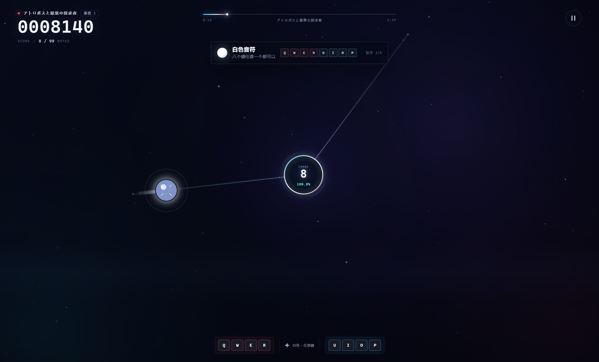
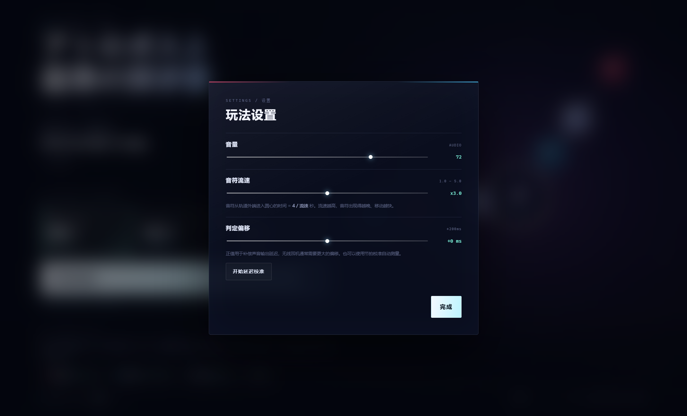
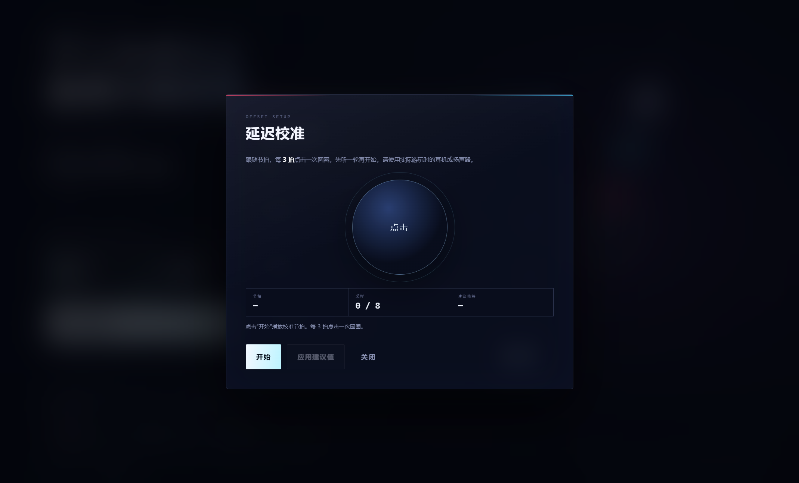

# 双轨音乐游戏

一个本地运行的双轨节奏游戏，使用 **Electron + HTML/CSS/Canvas 2D** 开发。当前包含一首曲目、三档难度、选曲界面、新手教学、音符流速和延迟校准。


## 功能

- 两条直线轨道，随歌曲节拍改变角度与长度
- 红 / 蓝 / 白三种音符，对应不同键位
- 音符中心与中心圆圆心重合时判定命中
- `PERFECT ±40ms` / `GOOD ±60ms` / 超出 `MISS`
- 连击与实时准确率显示在圆心内部
- 圆心随连击成长，MISS 时缩回
- 独立选歌界面
- 三档难度：`难度 1 / 难度 2 / 难度 3`
- 难度 1 带五段新手教学
- 音符流速 `1.0–5.0`
- 判定偏移 `−200ms ~ +200ms`
- 每 3 拍点击一次的延迟校准
- 本地 Electron 桌面程序，不是网页

## 画面

| 游戏与教学 | 设置 | 延迟校准 |
| --- | --- | --- |
|  |  |  |

## 快速开始

### 1. 准备歌曲

仓库不包含受版权保护的歌曲音频。请把你自己的 MP3 放到：

```text
assets/track.mp3
```

要求与说明见 [assets/README.md](assets/README.md)。

### 2. 安装依赖

需要 Node.js 22.12 或更高版本。

```powershell
npm install
```

### 3. 启动开发版

```powershell
npm start
```

### 4. 打包 Windows 程序

```powershell
npm run dist
```

输出：

```text
dist\MusicGame-win32-x64\MusicGame.exe
```

如果 Electron 官方下载超时，可以先设置镜像：

```powershell
$env:ELECTRON_MIRROR = "https://npmmirror.com/mirrors/electron/"
npm run dist
```

## 操作

| 音符 | 按键 |
| --- | --- |
| 红色 | `Q` / `W` / `E` / `R` 任意一个 |
| 蓝色 | `U` / `I` / `O` / `P` 任意一个 |
| 白色 | 八个键任意一个 |
| 暂停 | `Esc` / `Space` |
| 结算页重开 | `R` |
| 全屏 | `F11` |

命中条件：**音符中心与中心圆圆心重合时，按下对应颜色的键。**

连击数与实时准确率显示在圆心内部。圆心初始半径是音符半径的 **1.5 倍**，随连击增加趋近 **2.5 倍**；MISS 时连击归零，圆心缩回 1.5 倍。

## 设置

菜单、选歌页和暂停页都可以打开“设置”。

### 音符流速

范围 `1.0–5.0`。音符从轨道外端进入圆心的时间为：

```text
4 / 流速 秒
```

例如：

- 流速 1.0：约 4 秒
- 流速 3.0：约 1.33 秒
- 流速 5.0：约 0.8 秒

流速越高，音符出现得越晚、移动越快。

### 判定偏移与延迟校准

判定偏移范围 `−200ms ~ +200ms`，正值用于补偿音频输出延迟。

延迟校准流程：

1. 播放节拍，每 **3 拍**点击一次圆圈
2. 采集 8 次点击
3. 去掉前两次热身，计算平均偏移
4. 显示建议值，可一键应用

校准方法的来源是对 APKS 中 `SettingsLayerV2Offset` / `showSync` 与原生字符串的分析；实现中未复制或分发原作资源。

## 当前谱面

歌曲：**しーけー — アトロポスと最果の探求者**

- BPM：230
- 时长：157.76 秒（2:37）
- 首拍偏移：约 1.200 秒

| 难度 | 音符数 |
| --- | --- |
| 难度 1（新手） | 99 |
| 难度 2 | 278 |
| 难度 3 | 411 |

谱面从歌曲的旋律与鼓点起音检测结果中选点，而不是只按小节模板铺音符。

## 项目结构

```text
.
├─ assets/
│  ├─ README.md            # 歌曲文件说明
│  └─ track.mp3            # 本地歌曲，不提交
├─ desktop/
│  ├─ main.js              # Electron 主进程
│  ├─ icon.ico
│  └─ icon.png
├─ docs/                   # README 截图
├─ js/
│  ├─ chart-data.js        # 音符、轨道、教学数据
│  ├─ chart.js             # 轨道律动与几何
│  ├─ audio.js             # 音频控制
│  └─ game.js              # 渲染、判定、计分、设置、校准
├─ index.html
├─ style.css
├─ package.json
├─ LICENSE
└─ README.md
```

## 谱面数据格式

```js
{ "time": 12.345, "type": "red", "lane": 0 }
```

- `time`：从音频 0 秒开始的时间，单位秒
- `type`：`red` / `blue` / `white`
- `lane`：`0` 或 `1`，对应两条轨道

教学步骤在 `js/chart-data.js` 的 `tutorial` 数组中，字段为 `start` / `end` / `title` / `body` / `type` / `keys`。

轨道颜色在 `js/chart-data.js` 的 `lines` 数组中，`tint` 为视觉颜色，`baseAngle` 为基准方向；节拍律动在 `js/chart.js` 的 `buildLines()` 中生成。

## 上传到 GitHub

仓库已经包含 `.gitignore`，以下内容不会被提交：

- `node_modules/`
- `dist/`
- `.cache/`
- `assets/track.mp3`
- 本地启动脚本和测试产物

首次上传：

```powershell
git init
git add .
git commit -m "Initial commit"
git branch -M main
git remote add origin https://github.com/<你的用户名>/<仓库名>.git
git push -u origin main
```

如果想确认实际会被提交的文件：

```powershell
git status
```

应该能看到源码、`package.json`、`README.md`、`docs/` 和 `LICENSE`，但看不到 `dist/` 与 `assets/track.mp3`。

## 许可

- 代码：[MIT License](LICENSE)
- 歌曲音频不包含在本仓库中，版权归原曲作者及相关权利方所有
- 本项目与 Arcaea 及其权利方无关；延迟校准仅参考公开安装包中的交互流程，未使用其美术、音频或其他资源
